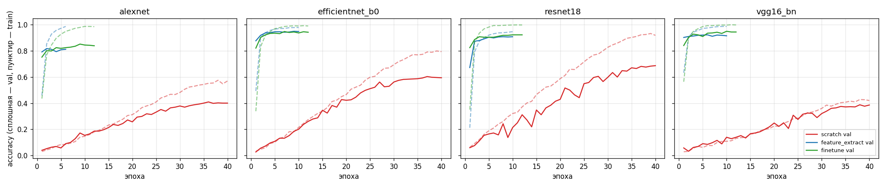
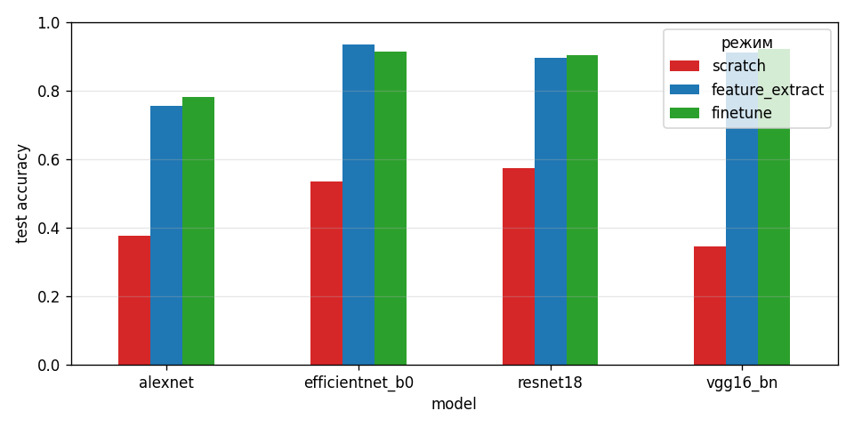

# Классификация пород кошек и собак (Oxford-IIIT Pet) на PyTorch

## Задача

Многоклассовая классификация изображений: **37 пород** кошек и собак из
[Oxford-IIIT Pet Dataset](https://www.robots.ox.ac.uk/~vgg/data/pets/).

Цель — написать на чистом PyTorch даталоадеры, цикл обучения и подсчёт метрик, а затем
сравнить архитектуры из `torchvision` в трёх режимах:

| режим | что происходит |
|---|---|
| `scratch` | случайная инициализация, учится вся сеть |
| `feature_extract` | веса ImageNet, backbone заморожен, учится только новый последний слой |
| `finetune` | веса ImageNet, учится вся сеть (backbone с LR в 10 раз ниже, чем у головы) |

Архитектуры: **AlexNet, VGG16-BN, ResNet18, EfficientNet-B0**.

## Данные и EDA

Подробно: [`notebooks/eda.ipynb`](notebooks/eda.ipynb).

* около 7.4k картинок, 37 классов (12 кошачьих и 25 собачьих пород), классы почти сбалансированы;
* официальный `test` (3669) оставлен тестом, `trainval` (3680) поделён стратифицированно на train/val 85/15;
* около 85 картинок на класс в train: данных мало, поэтому transfer learning должен сильно выигрывать у обучения с нуля;
* задача fine-grained: часть пород очень похожа (питбуль и стаффорд, британская и русская голубая).

Предобработка (`scripts/prepare_data.py`): картинки один раз уменьшаются до 256px по короткой стороне,
чтобы на 2 CPU в Colab декодирование JPEG не тормозило GPU.
Аугментации train: `RandomResizedCrop(224, scale=(0.5, 1))`, `HorizontalFlip`, `ColorJitter(0.2)`;
val/test: `Resize(256)` + `CenterCrop(224)`; нормализация по статистикам ImageNet.

## Обучение

* оптимизатор AdamW, weight decay 0.05, label smoothing 0.1, gradient clipping 1.0;
* LR: линейный warmup и косинусное затухание (шаг — батч);
* mixed precision (AMP) на GPU, batch size 64, seed 42;
* early stopping по val accuracy; в тест идёт лучший по val чекпоинт;
* scratch: до 40 эпох, feature_extract: 10, finetune: 12 (точные значения в `configs/experiments/`);
* метрики: accuracy и macro-F1 (`src/utils/metrics.py`), логи в TensorBoard (опционально W&B).

## Результаты

> Таблица заполняется после запуска: `python scripts/make_report.py` пишет `results/results.md`.

<!-- RESULTS:START -->
| model | scratch | feature_extract | finetune |
|:--|:--|:--|:--|
| alexnet | | | |
| vgg16_bn | | | |
| resnet18 | | | |
| efficientnet_b0 | | | |
<!-- RESULTS:END -->

Полная таблица (параметры, эпохи, время): [`results/results.md`](results/results.md).




### Выводы

> Заполнить по фактическим цифрам. Вопросы, на которые нужно ответить:
>
> 1. Насколько pretrained-модели обгоняют обучение с нуля и почему (мало данных; ImageNet уже содержит много пород собак и кошек).
> 2. Что лучше: feature extraction или полный finetune, и для каких архитектур разница больше.
> 3. Как точность соотносится с размером модели и временем эпохи (EfficientNet-B0 с 4M параметров против VGG16 со 134M).
> 4. Как ведут себя train и val кривые при обучении с нуля (переобучение).
> 5. Какие породы путает лучшая модель (`results/confusion_matrix_best.png`).

## Структура репозитория

```
├── configs/
│   ├── base.yaml                 # общие параметры (данные, обучение, логирование)
│   └── experiments/              # 12 конфигов <model>_<mode>.yaml, наследуют base.yaml
├── notebooks/
│   ├── eda.ipynb                 # разведочный анализ
│   └── colab_train.ipynb         # запуск всех экспериментов в Google Colab
├── scripts/
│   ├── prepare_data.py           # скачивание, ресайз, разбиение train/val/test
│   ├── train.py                  # обучение одной модели по конфигу + тест
│   ├── run_all.sh                # все эксперименты подряд
│   ├── evaluate.py               # отчёт по классам, матрица ошибок
│   └── make_report.py            # сводная таблица и графики в results/
├── src/
│   ├── data/dataset.py           # Dataset, трансформации, DataLoader'ы
│   ├── models/factory.py         # модели torchvision, замена головы, заморозка, группы LR
│   ├── training/trainer.py       # train/val loop, AMP, early stopping, чекпоинты, resume
│   └── utils/                    # конфиги, seed, метрики, логгеры
├── results/                      # итоговые таблицы и графики (коммитятся, весов нет)
└── requirements.txt
```

## Как запустить

### Google Colab (рекомендуется, бесплатного T4 достаточно)

Откройте [`notebooks/colab_train.ipynb`](notebooks/colab_train.ipynb) в Colab, выберите среду T4 GPU,
укажите `REPO_URL` и запускайте ячейки по порядку. Данные, чекпоинты и логи сохраняются на Google Drive
(`MyDrive/oxford_pets`), поэтому после отключения Colab достаточно запустить ячейки снова: завершённые
эксперименты пропустятся, прерванный продолжится с последней эпохи.

Место на Drive: веса лучших моделей занимают около 2.5 ГБ (больше всего VGG16, ~0.5 ГБ на эксперимент).

### Локально (нужен GPU с CUDA)

```bash
python -m venv .venv
source .venv/bin/activate          # Windows: .venv\Scripts\activate
# torch с CUDA: https://pytorch.org/get-started/locally/
pip install -r requirements.txt

python scripts/prepare_data.py                     # ~800 МБ, около 5 минут
python scripts/train.py --config configs/experiments/resnet18_finetune.yaml
bash scripts/run_all.sh                            # все 12 экспериментов
python scripts/make_report.py                      # таблица и графики в results/
python scripts/evaluate.py --config configs/experiments/resnet18_finetune.yaml
tensorboard --logdir outputs
```

Полезные опции `train.py`:

```bash
--output-root PATH       # куда писать чекпоинты/логи (по умолчанию outputs/)
-o train.epochs=5        # переопределить любой параметр конфига (можно несколько раз)
--limit-batches 3        # быстрый прогон для отладки
--force                  # перезапустить завершённый эксперимент с нуля
```

Новый эксперимент — новый YAML в `configs/experiments/` с `base: configs/base.yaml`
и переопределёнными полями; имя файла становится именем эксперимента.
